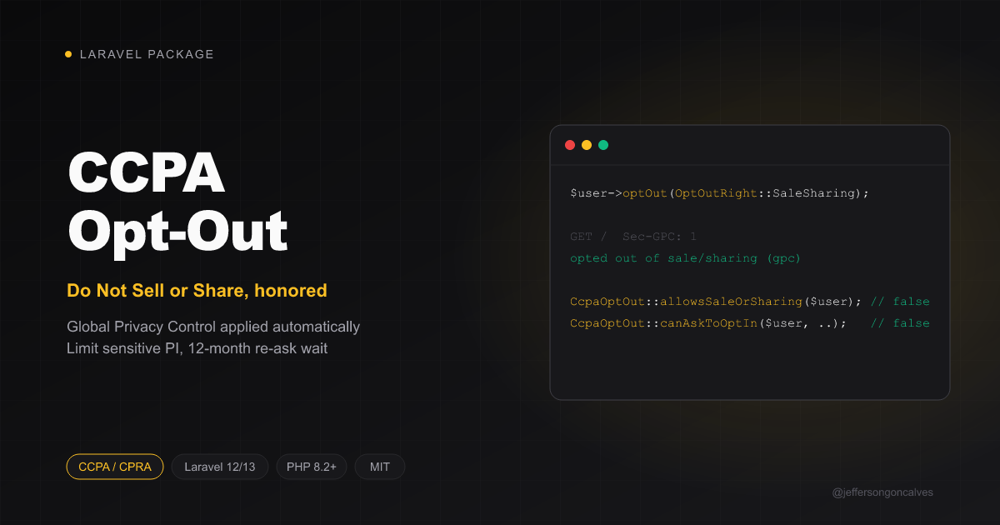

# Laravel CCPA Opt-Out



[](https://packagist.org/packages/jeffersongoncalves/laravel-ccpa-opt-out)
[](https://github.com/jeffersongoncalves/laravel-ccpa-opt-out/actions/workflows/tests.yml)
[](https://packagist.org/packages/jeffersongoncalves/laravel-ccpa-opt-out)

Opt-out ledger for the California Consumer Privacy Act, as amended by the CPRA. It is part of the [laravel-ccpa](https://github.com/jeffersongoncalves/laravel-ccpa) suite.

Californians can tell a business not to sell or share their personal information (Cal. Civ. Code §1798.120), and to limit the use of their sensitive personal information (§1798.121). A Global Privacy Control signal sent by the browser counts as an opt-out request (CCPA Regulations §7025). This package:

- records every opt-out and opt-in as a new row, and never updates or deletes a row;
- **honors Global Privacy Control** with a middleware: a `Sec-GPC: 1` request opts the user, or the browser, out of sale and sharing;
- works for logged-in consumers and for visitors, who get a random id in an encrypted cookie. A visitor's choices move to the account on login;
- tells you when you may ask again: you must wait 12 months after an opt-out before asking the consumer to opt back in (§1798.135(c)(4));
- offers an endpoint for your "Do Not Sell or Share My Personal Information" and "Limit the Use of My Sensitive Personal Information" links, plus a Blade condition for ad tags.

> This package gives you tooling. It does not make you compliant on its own. You still have to stop selling or sharing, and pass the request on to the third parties involved.

## Installation

```bash
composer require jeffersongoncalves/laravel-ccpa-opt-out
php artisan vendor:publish --tag="ccpa-opt-out-migrations"
php artisan migrate
php artisan vendor:publish --tag="ccpa-opt-out-config"   # optional
```

## Usage

```php
use JeffersonGoncalves\CcpaOptOut\Concerns\HasOptOuts;
use JeffersonGoncalves\CcpaOptOut\Enums\OptOutRight;

class User extends Authenticatable
{
    use HasOptOuts;
}

$user->optOut(OptOutRight::SaleSharing, 'privacy-page');
$user->hasOptedOut(OptOutRight::SaleSharing);    // true
$user->optIn(OptOutRight::SaleSharing);
```

From anywhere, for users or browser ids:

```php
use JeffersonGoncalves\CcpaOptOut\Facades\CcpaOptOut;

CcpaOptOut::allowsSaleOrSharing($user);                     // false after an opt-out of sale/sharing
CcpaOptOut::allowsSensitiveUse($user);                      // false after "limit the use"
CcpaOptOut::canAskToOptIn($user, OptOutRight::SaleSharing); // false for 12 months after an opt-out
CcpaOptOut::history($user);
```

Every choice dispatches `JeffersonGoncalves\CcpaOptOut\Events\OptOutRecorded`. On an opt-out of sale and sharing, use it to tell the third parties you sold or shared the information to (Regulations §7026(f)).

### Global Privacy Control

Add the middleware to your web routes:

```php
// bootstrap/app.php
->withMiddleware(function (Middleware $middleware) {
    $middleware->web(append: ['ccpa.gpc']);
})
```

A request with `Sec-GPC: 1` records an opt-out of sale and sharing for the logged-in user, or for the browser's cookie id. It is recorded once. Turn it off with `honor_gpc => false`.

### Links and endpoint

Enable the endpoint with `route.enabled => true`, then post from your two links:

```js
fetch('/ccpa/opt-out', {
    method: 'POST',
    headers: { 'Content-Type': 'application/json', 'X-CSRF-TOKEN': token },
    body: JSON.stringify({ right: 'sale_sharing', opted_out: true }),  // or 'limit_sensitive'
});
```

When a visitor logs in, the latest choice for each right is copied to the account as a new record, with source `claimed`. Turn it off with `route.claim_on_login => false`.

### Ad tags

```blade
@ccpaSaleAllowed
    <script src="https://ads.example.com/pixel.js"></script>
@endccpaSaleAllowed
```

The block renders nothing when the user or browser opted out, or when the request carries a GPC signal.

### Append-only

Calling `update()` or `delete()` on an `OptOutRecord` throws an exception. The IP address and user agent columns are declared with [laravel-ccpa](https://github.com/jeffersongoncalves/laravel-ccpa)'s `#[PersonalData]`, so you can still deidentify them with `$record->anonymizePersonalData()`.

## Testing

```bash
composer test
```

## Changelog

See [CHANGELOG](CHANGELOG.md).

## License

The MIT License (MIT). See [License File](LICENSE.md).
